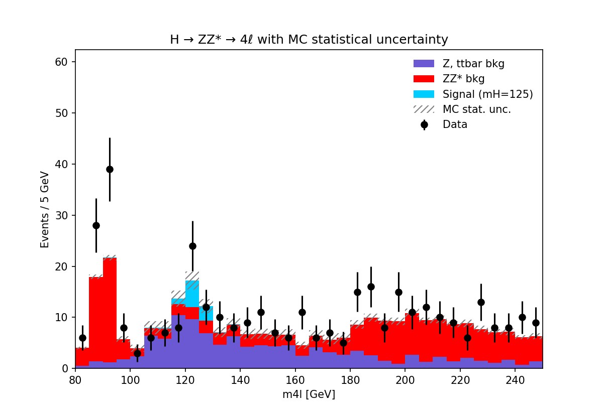
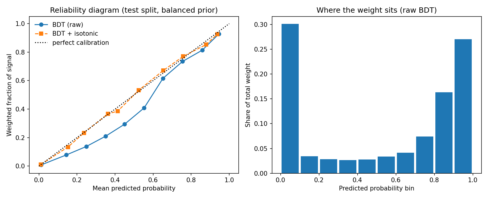
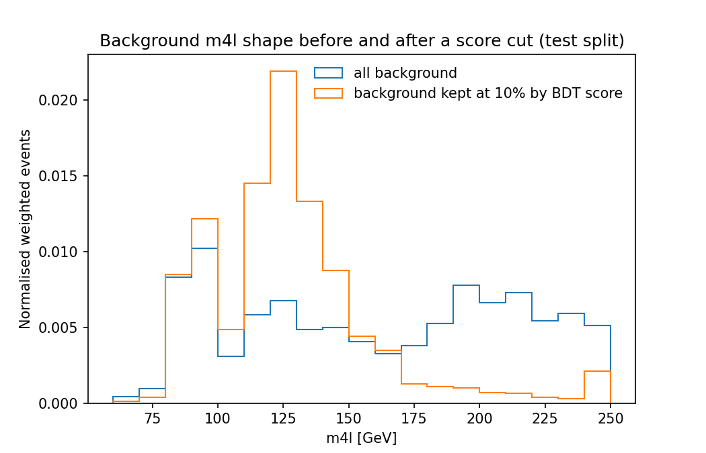

# H → ZZ* → 4ℓ with ATLAS Open Data

## Goal
Reproduce the Higgs → ZZ* → 4 lepton analysis from the ATLAS Open Data
(2020 release, 13 TeV, 10 fb⁻¹), then extend it with a signal/background
classifier and audit its leakage, calibration and mass dependence.

## Data
- ATLAS 13 TeV 4-lepton samples, CERN Open Data Portal
- DOI: 10.7483/OPENDATA.ATLAS.2Y1T.TLGL (CC0)
- Educational dataset; not suited for scientific publications.

---

## Part 1: reproduction of the official analysis

**Method.** Event selection and weights follow the official ATLAS Open Data
notebook: first four leptons, total charge 0, lepton types eeee / μμμμ / eeμμ.
Simulation is weighted by cross-section, luminosity and scale factors.

**Validation.**
- Per-file event counts (nIn / nOut) match the official notebook.
- Data events after selection: 507 (official notebook: 507).

**Result.**

In the 120–130 GeV window: data = 36, background = 21.4, signal = 8.0.
This is a rough event count; no systematic uncertainties are included.

**Open question.** Data exceeds the simulation at about 85–95 GeV
(bins 85–90 and 90–95 GeV: data 28 and 39 vs MC 17.9 and 21.7; rough pulls
1.9 and 2.8, MC statistical uncertainty only). I first suspected low MC
statistics, but the MC statistical uncertainty is below one event per bin, so
this does not explain the difference. The cause is not identified. The region is
away from the Higgs signal window (120–130 GeV).

---

## Part 2: classifier, leakage audit, calibration

**Setup.** Gradient-boosted trees (scikit-learn `HistGradientBoostingClassifier`)
separate H → ZZ* → 4ℓ simulation (label 1) from Standard Model background
simulation (label 0). Features: lepton $p_T$ and $|\eta|$ (ordered by $p_T$),
$p_T$ of the four-lepton system, channel. The four-lepton mass $m_{4\ell}$ is not
a feature unless stated. Data is not used for training. Training weights are
sample-level ($|\text{yield}|$ divided by events per sample) and class-balanced.
Split: 60/20/20, stratified by sample.

### Leakage audit
- No duplicate (run, event) pairs inside any sample; no kinematic fingerprint
  (features rounded to 3 decimals) shared between signal and background. This
  excludes exact duplicates only, not statistical dependence.
- About 3% of simulated events have exactly zero weight; several samples have
  negative weights (llll 10.4%, Zee 5.8%, Zmumu 2.0%).
- The signal class is about 90% ggH by yield; ZH contributes about 0.02%.

### Calibration
- **Balanced prior:** isotonic recalibration (fit on validation only) lowered the
  weighted ECE in all 6 runs (3 seeds, with and without zero-weight events):
  raw ECE 0.025–0.037, isotonic 0.007–0.018.
- **Physical prior** (signal fraction 0.0242 from signed yields): the raw score is
  badly calibrated (Brier skill score −5.6). Isotonic: BSS 0.10 (95% CI
  0.045–0.143). Bayes prior shift: BSS 0.075 (CI −0.020–0.147). The two
  corrections are not distinguishable (difference CI −0.006–0.075).
- ECE is reported next to BSS because at a 2.4% signal fraction ECE alone is
  uninformative.
  

### Mass dependence
- The score is correlated with $m_{4\ell}$ although $m_{4\ell}$ is not an input:
  after a cut keeping 10% of the background, 36% of that background lies in
  115–135 GeV (9% before the cut).
- Mass-flattened training lowers this to 14% but cuts the effective training
  statistics by about 16×, so the two effects cannot be separated.
- A BDT using $m_{4\ell}$ alone (AUC 0.972) beats the kinematic BDT (AUC 0.933);
  it is therefore not a mass-blind classifier.
  

### Selection comparison
5-fold cross-fitting (every event scored out-of-fold once), thresholds set at a
fixed signal efficiency, physical yields for 10 fb⁻¹. Asimov significance:

| signal eff. | mass window | window + one $p_T$ cut | BDT (kin. + $m_{4\ell}$) |
|---|---|---|---|
| 0.3 | 1.20 | 2.12 | 2.34 |
| 0.4 | 1.44 | 2.26 | 2.70 |
| 0.5 | 1.58 | 2.16 | 2.76 |
| 0.6 | 1.65 | 2.12 | 2.65 |

Paired bootstrap of BDT minus (window + $p_T$ cut), 95% CI: [0.30, 0.99] at
efficiency 0.5 (central value about +0.6); [−0.02, 0.92] at 0.4; [−0.40, 0.77] at 0.3. The BDT's advantage is
supported at one of three tested efficiencies. A BDT without $m_{4\ell}$ is worse
than the plain mass window ($Z \approx 1.0$–$1.2$).

### Limitations
- Educational dataset; the classical baseline is crude (no isolation or impact
  parameter variables), so this is not a comparison with the ATLAS analysis.
- A few hundred Z/ttbar events with large weights dominate the background
  uncertainty (a handful of them survive the BDT cut).
- Bootstrap intervals resample evaluation events only, not training or threshold
  choice; one cross-fitting split.
- Physical weights are sample-level, not per-event.

### Corrections made during the work
- An early version used $|w|$ yields for the physical prior (signal fraction
  0.0167); signed yields give 0.0242.
- The four-lepton mass was divided by 1000 twice in the feature table (it was not
  a training feature, so the BDT results were unaffected; one plot was empty).
- A narrowest-window helper returned a zero-width window; fixed and rerun.

## Reproduce
Open the notebook with the Colab badge and choose Runtime → Run all.
Bootstrap intervals and some table entries can differ in the last digit between runs.
Data files are downloaded to `data_cache/` on first run.

## Credits
Selection, weights and sample list follow the official ATLAS Open Data notebook
(`atlas-outreach-data-tools/notebooks-collection-opendata`). Part 2 is my own
extension.
