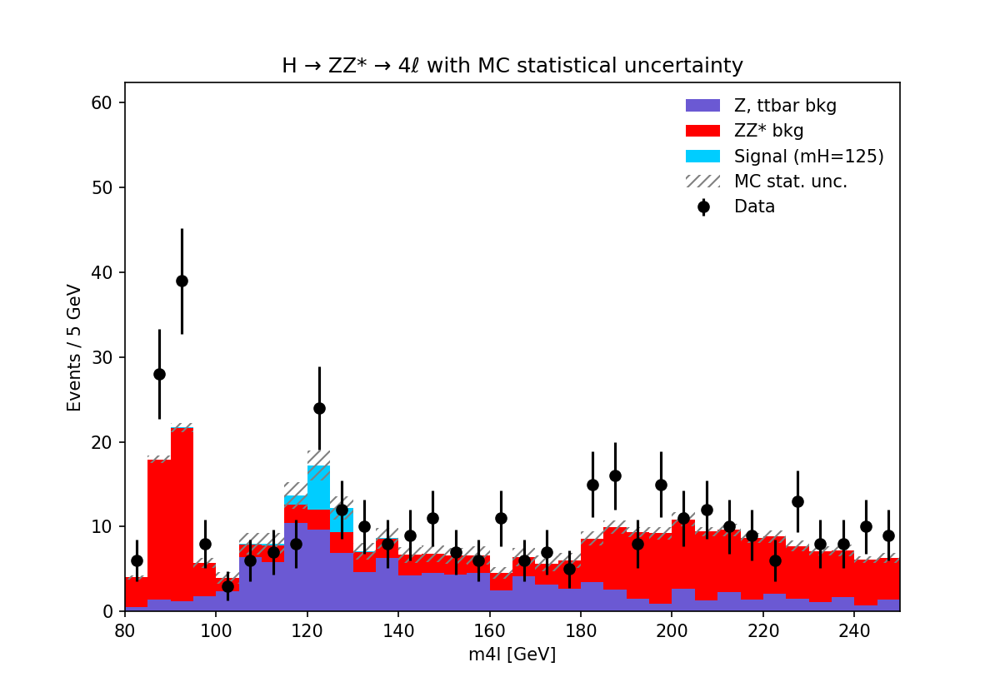
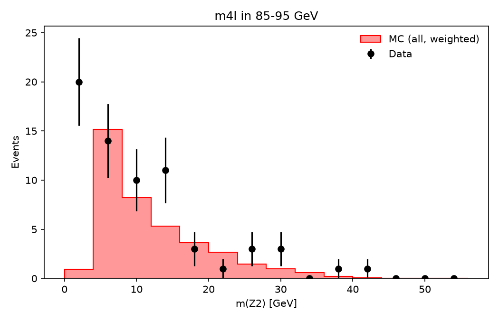
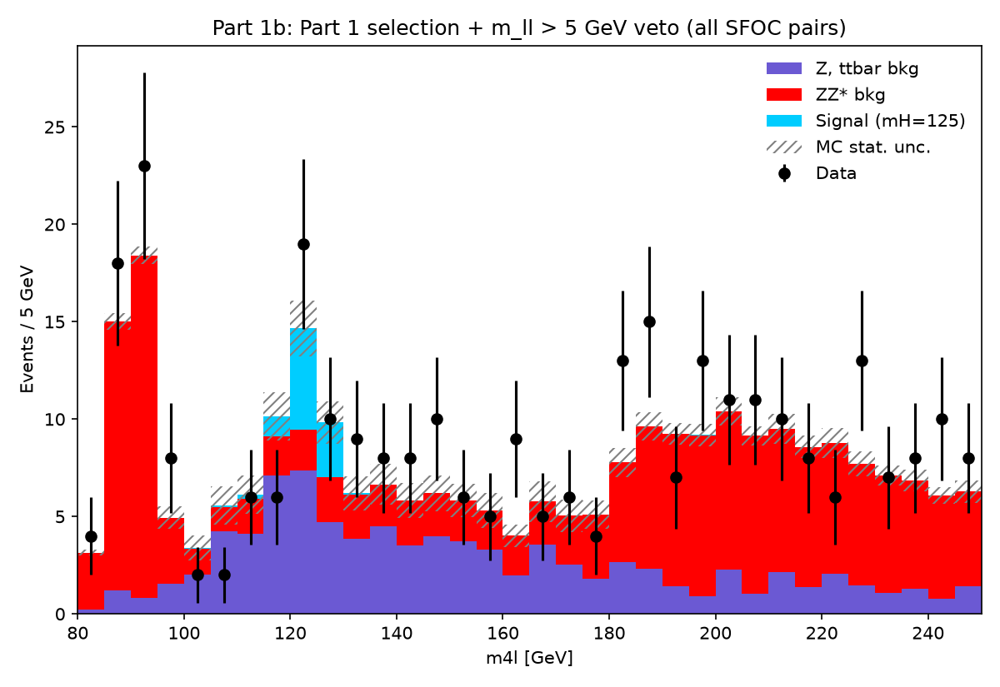
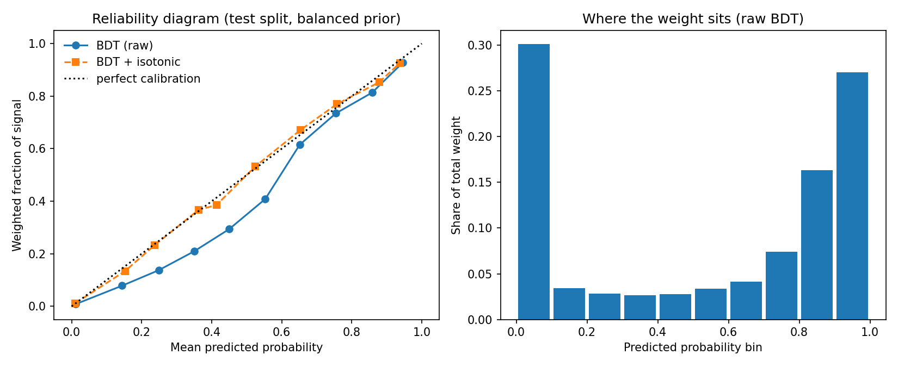
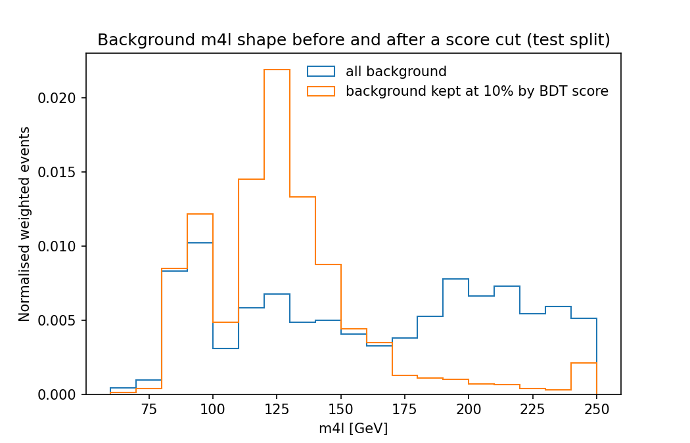
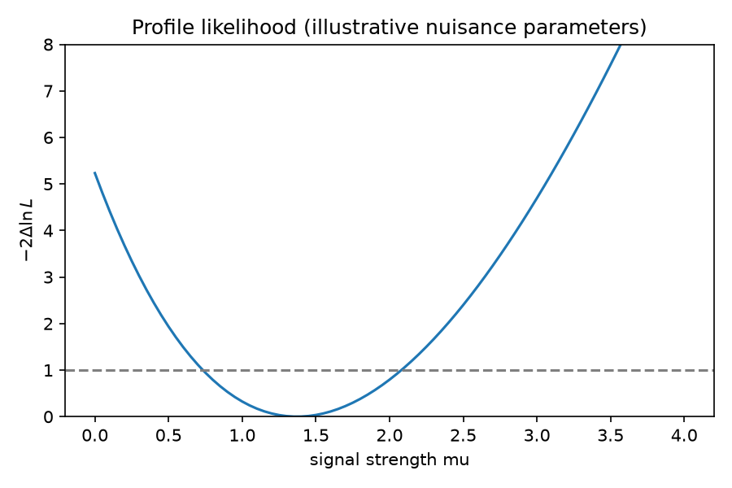

# H → ZZ* → 4ℓ with ATLAS Open Data

[](https://colab.research.google.com/github/mutallimov7/CERN-Open-Data-Analysis/blob/main/analysis.ipynb)

## Goal
Reproduce the Higgs → ZZ* → 4 lepton analysis from the ATLAS Open Data
(2020 release, 13 TeV, 10 fb⁻¹), then extend it with a signal/background
classifier and audit its leakage, calibration and mass dependence.

## Key findings
- **Reproduction matches the reference.** Per-file event counts match and 507 data events
  pass the selection (official notebook: 507).
- **The data excess at 85–95 GeV is mostly a selection effect.** In the official selection
  the window holds 67 data events against 39.6 expected (Poisson p = 4.5·10⁻⁵, MC statistical
  uncertainty only). 20 of them have a very small second-pair mass, m(Z2) < 4 GeV, where the
  simulation predicts 0.9. Applying the ATLAS-style J/ψ veto (m_ℓℓ > 5 GeV for every
  same-flavour opposite-charge pair) leaves 41 vs 33.4 (p = 0.11), not significant. Details in
  [Part 1b](#part-1b-low-mass-dilepton-veto-and-the-85-95-gev-excess).
- **Signal strength.** A profile-likelihood fit (pyhf, 105–160 GeV) gives μ = 1.37 (68% interval
  0.75–2.05) with the veto, 2.3σ observed vs 1.7σ expected. Consistent with μ = 1; not a
  discovery. The nuisance parameters are illustrative assumptions. See [Part 3](#part-3-signal-strength-fit-pyhf).
- **The classifier score is not mass-blind.** It correlates with m₄ℓ although m₄ℓ is not an
  input, and its advantage over a simple mass-window selection is supported at one of three
  tested signal efficiencies ([Part 2](#part-2-classifier-leakage-audit-calibration)).

## Data
- ATLAS 13 TeV 4-lepton samples, CERN Open Data Portal
- DOI: 10.7483/OPENDATA.ATLAS.2Y1T.TLGL (CC0)
- Educational dataset; not suited for scientific publications.

---

## Part 1: reproduction of the official analysis

**Method.** Event selection and weights follow the official ATLAS Open Data
notebook: first four leptons, total charge 0, lepton types eeee / μμμμ / eeμμ.
Simulation is weighted by cross-section, luminosity and scale factors.

**Validation.**
- Per-file event counts (nIn / nOut) match the official notebook.
- Data events after selection: 507 (official notebook: 507).

**Result.**



In the 120–130 GeV window: data = 36, background = 21.4, signal = 8.0.
This is a rough event count; no systematic uncertainties are included.

**The 85–95 GeV excess.** Data exceeds the simulation at about 85–95 GeV
(bins 85–90 and 90–95 GeV: data 28 and 39 vs MC 17.9 and 21.7; rough pulls
1.9 and 2.8, MC statistical uncertainty only). Taken together the window holds
67 data events against 39.6 expected (data/MC = 1.69, Poisson p = 4.5·10⁻⁵, MC statistical
uncertainty only). The window was chosen after looking at the two bins, so this p-value is
descriptive. Scanning all 34 five-GeV bins between 80 and 250 GeV, the smallest single-bin p is 5·10⁻⁴,
about 0.02 after multiplying by the number of bins. The MC statistical uncertainty is below one event per
bin, so low MC statistics do not explain it. The region is away from the Higgs signal window
(120–130 GeV). Part 1b explains most of it.

---

## Part 1b: low-mass dilepton veto and the 85–95 GeV excess

Scripts: `scripts/z_peak_diagnostics.py`, `scripts/part1b_mll_veto.py`.
Output: `results/z_peak_diagnostics.txt`, `results/part1b_mll_veto.txt`.

### What the diagnostics showed
Splitting the 85–95 GeV window by the mass of the second lepton pair, m(Z2) (the pair not closest
to m_Z; both pairs are same-flavour, opposite-charge):

| m(Z2) | data | MC |
|---|---|---|
| < 4 GeV | 20 | 0.93 |
| ≥ 4 GeV | 47 | 38.2 (data/MC = 1.23, p = 0.09) |

The ZZ* simulation has an edge in m(Z2): per 1 GeV bin over all m₄ℓ it gives
0.01, 0, 0.02, 0.85, 7.46, 7.27, … while the data are flat down to zero (12, 8, 9, 23, 8, 10, …).
Data in the 3–4 GeV bin are high (23 vs 8–12 in neighbours), and a narrower look finds 12 events in
[2.9, 3.3) GeV against 6 and 7 in the neighbouring 0.4 GeV ranges. That is suggestive of the
J/ψ mass (3.097 GeV) but the counts are small and I do not claim the events are J/ψ.



Splits by lepton channel (homogeneity p = 0.22) and by data period (p = 0.07) show no evidence of
a channel or period dependence; the counts are small.

Hypotheses I tested and **did not** find support for: low MC statistics (ruled out above), and a Z → 4ℓ
contribution as the main explanation. My first check, comparing medians of m(Z2) and the softest
lepton pT between data and MC, looked identical and hid the feature; the full distribution showed it.

### Part 1b selection
The published ATLAS H → ZZ* → 4ℓ analyses suppress J/ψ and other low-mass resonances by requiring
m_ℓℓ > 5 GeV for the same-flavour opposite-charge lepton pairs
([arXiv:1712.02304](https://arxiv.org/abs/1712.02304), [arXiv:2306.11379](https://arxiv.org/abs/2306.11379)).
The Open Data notebook selection does not include this requirement. Part 1b adds **only** this veto
to the Part 1 selection (every same-flavour opposite-charge pair among the four leptons must have
m_ℓℓ > 5 GeV; events with no such pair pass). It is not the full ATLAS selection: there are no lepton
pT, isolation or impact-parameter requirements, no ΔR cuts and no m₁₂/m₃₄ windows. The 5 GeV value
is taken from the literature, not tuned on this data, but the reason for applying it came from the
diagnostics above, so Part 1b is not independent of that look.

| window | selection | data | MC | data/MC | Poisson p |
|---|---|---|---|---|---|
| 85–95 GeV | Part 1 | 67 | 39.6 | 1.69 | 4.5·10⁻⁵ |
| 85–95 GeV | Part 1b | 41 | 33.4 | 1.23 | 0.11 |
| 120–130 GeV | Part 1 | 36 | 29.4 | 1.22 | 0.13 |
| 120–130 GeV | Part 1b | 29 | 24.5 | 1.18 | 0.20 |

MC statistical uncertainty only, no systematic uncertainties. The veto removes 71 of 507 data events
and 34.8 of 397.8 expected MC events (Z/ttbar 25.1, ZZ* 9.6, signal 0.08). The data lose about twice as
many events as the MC predicts, as expected if the MC does not model the low-mass region.
After the veto the smallest single-bin p over 34 bins is 0.022 (about 0.74 after multiplying by the
number of bins).



**What I do not know.** I could not find the generator-level lower dilepton-mass cut for the
Sherpa llll sample (channel 363490) in the public ATLAS Open Data documentation, which lists it only
as "Sherpa 2.2, ℓ⁺ℓ⁻ℓ⁺ℓ⁻ final states". The edge in m(Z2) near 3–4 GeV is measured in the
reconstructed simulation, but I have not confirmed that it comes from a generator cut. A remaining
excess of about 7.6 events (data/MC = 1.23) at 85–95 GeV after the veto is not significant.

---

## Part 2: classifier, leakage audit, calibration

**Setup.** Gradient-boosted trees (scikit-learn `HistGradientBoostingClassifier`)
separate H → ZZ* → 4ℓ simulation (label 1) from Standard Model background
simulation (label 0). Features: lepton $p_T$ and $|\eta|$ (ordered by $p_T$),
$p_T$ of the four-lepton system, channel. The four-lepton mass $m_{4\ell}$ is not
a feature unless stated. Data is not used for training. Training weights are
sample-level ($|\text{yield}|$ divided by events per sample) and class-balanced.
Split: 60/20/20, stratified by sample.

### Leakage audit
- No duplicate (run, event) pairs inside any sample; no kinematic fingerprint
  (features rounded to 3 decimals) shared between signal and background. This
  excludes exact duplicates only, not statistical dependence.
- About 3% of simulated events have exactly zero weight; several samples have
  negative weights (llll 10.4%, Zee 5.8%, Zmumu 2.0%).
- The signal class is about 90% ggH by yield; ZH contributes about 0.02%.

### Calibration
- **Balanced prior:** isotonic recalibration (fit on validation only) lowered the
  weighted ECE in all 6 runs (3 seeds, with and without zero-weight events):
  raw ECE 0.025–0.037, isotonic 0.007–0.018.
- **Physical prior** (signal fraction 0.0242 from signed yields): the raw score is
  badly calibrated (Brier skill score −5.6). Isotonic: BSS 0.10 (95% CI
  0.045–0.143). Bayes prior shift: BSS 0.075 (CI −0.020–0.147). The two
  corrections are not distinguishable (difference CI −0.006–0.075).
- ECE is reported next to BSS because at a 2.4% signal fraction ECE alone is
  uninformative.
  

### Mass dependence
- The score is correlated with $m_{4\ell}$ although $m_{4\ell}$ is not an input:
  after a cut keeping 10% of the background, 36% of that background lies in
  115–135 GeV (9% before the cut).
- Mass-flattened training lowers this to 14% but cuts the effective training
  statistics by about 16×, so the two effects cannot be separated.
- A BDT using $m_{4\ell}$ alone (AUC 0.972) beats the kinematic BDT (AUC 0.933);
  it is therefore not a mass-blind classifier.
  

### Selection comparison
5-fold cross-fitting (every event scored out-of-fold once), thresholds set at a
fixed signal efficiency, physical yields for 10 fb⁻¹. Asimov significance:

| signal eff. | mass window | window + one $p_T$ cut | BDT (kin. + $m_{4\ell}$) |
|---|---|---|---|
| 0.3 | 1.20 | 2.12 | 2.34 |
| 0.4 | 1.44 | 2.26 | 2.70 |
| 0.5 | 1.58 | 2.16 | 2.76 |
| 0.6 | 1.65 | 2.12 | 2.65 |

Paired bootstrap of BDT minus (window + $p_T$ cut), 95% CI: [0.30, 0.99] at
efficiency 0.5 (central value about +0.6); [−0.02, 0.92] at 0.4; [−0.40, 0.77] at 0.3. The BDT's advantage is
supported at one of three tested efficiencies. A BDT without $m_{4\ell}$ is worse
than the plain mass window ($Z \approx 1.0$–$1.2$).

### Limitations
- Educational dataset; the classical baseline is crude (no isolation or impact
  parameter variables), so this is not a comparison with the ATLAS analysis.
- A few hundred Z/ttbar events with large weights dominate the background
  uncertainty (a handful of them survive the BDT cut).
- Bootstrap intervals resample evaluation events only, not training or threshold
  choice; one cross-fitting split.
- Physical weights are sample-level, not per-event.

---

## Part 3: signal-strength fit (pyhf)

Script: `scripts/pyhf_fit.py [part1|part1b]`. Output: `results/pyhf_fit_*.txt`, `figures/pyhf_profile_*.png`.

One channel, m₄ℓ in 105–160 GeV, 5 GeV bins. The signal (ggH + VBF + WH + ZH) is scaled by a signal
strength μ. The background is ZZ* plus Z/ttbar, each with its MC statistical uncertainty (`staterror`).
Two normalisation uncertainties are included for illustration: luminosity ±2% on every sample and
ZZ* ±10%. **These two sizes are my assumptions, not official ATLAS uncertainties.** Lepton efficiency,
energy scale and shape uncertainties are not modelled.

| selection | μ̂ (68% interval) | observed Z | expected Z (μ = 1, Asimov) |
|---|---|---|---|
| Part 1b | 1.37 (0.75–2.05) | 2.29σ (p₀ = 0.011) | 1.69σ |
| Part 1 | 1.60 (0.90–2.35) | 2.35σ (p₀ = 0.009) | 1.49σ |



Checks: at μ = 0 the profile gives −2ΔlnL ≈ 5.25, matching Z = 2.29. A plain counting estimate in the
120–130 GeV window (Part 1b) gives μ̂ = 1.57. Enlarging the assumed uncertainties to lumi 5%, ZZ* 30%
moves μ̂ to 1.32 and Z to 2.11; removing them gives 1.38 and 2.33. The Z/ttbar background comes from
only about 830 selected raw events (Zee 243, Zmumu 257, ttbar 334) with large weights, so its
`staterror` is an approximation.
The observed significance exceeds the expected one by about 1σ of upward fluctuation. This is an
educational dataset and not a measurement.

---

## Reproduce

### Local run (Parts 1b and 3, tests)
```bash
python -m venv .venv && source .venv/bin/activate
pip install -r requirements.txt        # pinned to the versions used (Python 3.14.4); other versions not tested
pytest                                 # unit tests: calibration metrics, Z-pair masses, SFOC veto quantity
python scripts/z_peak_diagnostics.py   # 85-95 GeV diagnostics
python scripts/part1b_mll_veto.py      # Part 1b
python scripts/pyhf_fit.py part1b      # or: part1
```
The first run downloads about 400 MB to `data_cache/` (ignored by git). Downloads resume after
a dropped connection and a file is accepted only if its size matches the server's.
The cross-section table `infofile.py` is fetched from a pinned commit
(`8509890af9a4db47f2c9908063c98d50b74123c2`) of the ATLAS Open Data notebooks, not from `master`.

### Notebook (Parts 1 and 2)
Open `analysis.ipynb` with the Colab badge and choose Runtime → Run all.
Bootstrap intervals and some table entries can differ in the last digit between runs.
The notebook installs `uproot==5.7.8`, `awkward==2.15.1` and `vector==1.9.0` and downloads
`infofile.py` from the same pinned commit as the scripts (the file is byte-identical to the current
`master` version). numpy, pandas, scikit-learn and matplotlib are the ones preinstalled in the Colab
image and are not pinned there; `requirements.txt` lists the versions used for the local scripts.
I ran the Part 1 cells locally with the pinned `infofile.py` (507 data events, same window
numbers); I have not re-run the pinned notebook end to end in Colab.

## Repository layout
```
analysis.ipynb         Parts 1 and 2 (Colab notebook, outputs saved)
hzz4l/                 data access (pinned inputs, resumable download), selection, weights,
                       per-event table, calibration metrics
scripts/               z_peak_diagnostics.py, part1b_mll_veto.py, pyhf_fit.py
tests/                 pytest unit tests
results/, figures/     text and image outputs of the scripts
```

## Corrections made during the work
- An early version used $|w|$ yields for the physical prior (signal fraction
  0.0167); signed yields give 0.0242.
- The four-lepton mass was divided by 1000 twice in the feature table (it was not
  a training feature, so the BDT results were unaffected; one plot was empty).
- A narrowest-window helper returned a zero-width window; fixed and rerun.
- The new pair-mass code assumed every selected event has a same-flavour opposite-charge pair.
  Events such as e⁺e⁺μ⁻μ⁻ (total charge 0) have none: 164 events (2 data, 162 MC). Found when the
  window totals disagreed (39.16 vs 39.61); they are now reported separately and the totals agree.
- A first version of the fit script claimed that the expected significance is much smaller than
  the ATLAS value. That was not checked and was removed; the Asimov expected significance is
  computed instead.
- My first explanation attempt for the 85–95 GeV excess (a Z → 4ℓ contribution) was not supported by
  the data; see Part 1b.

## Credits
Selection, weights and sample list follow the official ATLAS Open Data notebook
(`atlas-outreach-data-tools/notebooks-collection-opendata`). Parts 1b, 2 and 3 are my own
extension. The J/ψ veto follows the published ATLAS analyses cited in Part 1b.

## License and citation
MIT (see `LICENSE`); citation metadata in `CITATION.cff`. The data are CC0.
